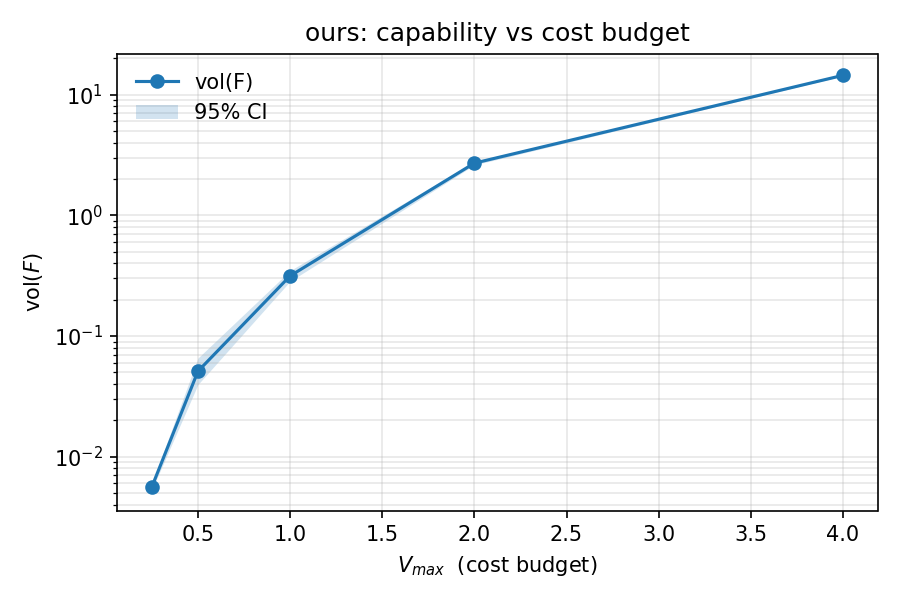
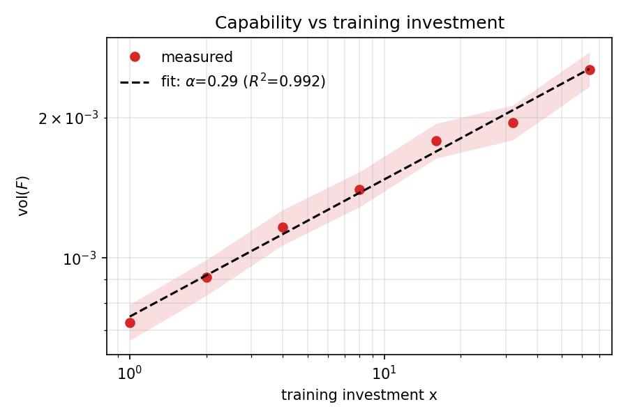
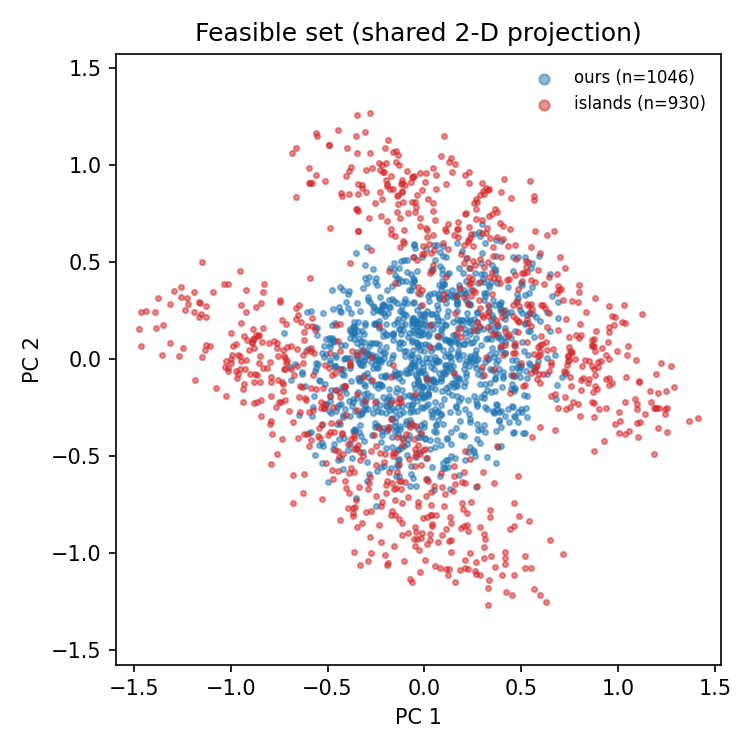

# capvol

**把"这个机器人到底能做到什么"量成一个数，并附上置信区间。**

[English](README.md)

---

成功率是每个人都在引用、却没人能横向比较的数字。它取决于你选的任务集、采样的重置分布、允许重试几次。两个实验室都报"92%"，测的不是同一件事——所以**"这台机器人比那台强"这句话在跨实验室的语境里是不可证伪的**。

如果你有目标条件化的价值函数 `V(s, g)`，"机器人能做什么"这件事就有定义了：

```
F(s0) = { g ∈ G : V(s0, g) < V_max }
```

以及那个所有人都想要、却几乎没人真的算出来的量：

```
能力 = vol(F)
```

`capvol` 为任意 `V` 估计这个体积——包括朴素蒙特卡洛只能返回 0 的区间——并且给出区间而不是一个点。

它还测量体积看不见的东西：**可行集是一整块，还是一把碎片。** 一个能到达 500 个互不相干目标的策略，无法在它们之间插值，于是每个新目标都是一项新技能。

---

## 安装

```bash
git clone https://github.com/tongriyaotxt/capvol.git
cd capvol
pip install -e ".[plot,test]"
```

必装依赖只有 `numpy`。`matplotlib` 用于 demo 和画图，`pytest` 用于测试。

---

## 最小用法

```python
import numpy as np
from capvol import BoxSpace, estimate

# 6 维目标空间：比如末端位姿包络
space = BoxSpace(low=-0.9 * np.ones(6), high=0.9 * np.ones(6))

# 你的价值函数：V(X)，X 形状 [N, d]，返回 [N]
# （单点函数用 capvol.pointwise 包一层即可）
def V(X):
    r = np.array([0.9, 0.8, 0.7, 0.6, 0.5, 0.45])
    return ((np.atleast_2d(X) / r) ** 2).sum(axis=1)

e = estimate(space, V, v_max=1.0, n=100_000)
print(e.describe())
# direct-lhs: rho=1.034e-02 [9.71e-03, 1.10e-02]  vol=3.517e-01  n=100000  ok=1034
```

这就是全部接口。其余都是它之上的视图。

---

## 能测什么

| 函数 | 回答什么问题 |
|---|---|
| `estimate(space, V, v_max)` | 这个策略能覆盖目标空间的多少？ |
| `connectivity(points)` | 可达集是一整块，还是很多块？ |
| `capability_vs_threshold(space, V, thresholds)` | 放宽代价预算，能力怎么长？ |
| `learning_curve(checkpoints, space, v_max)` | 能力是否随训练投入增长，指数是多少？ |
| `compare({name: V}, space, v_max)` | 同一坐标系下，哪个方法覆盖更多？ |
| `to_markdown(results)` / `to_json(...)` | 一张评审可核对的表 |

---

## 估计器怎么工作

两个区制，一套 API。区制自动选择，结果里永远写明跑的是哪一个。

### 直接法 —— 可行体积在 `G` 里是个看得见的比例

在目标空间做拉丁超立方采样，数可行样本，报 **Wilson** 区间。LHS 对每个坐标分层，同样样本量下方差比纯蒙特卡洛低一个量级。用 Wilson 而不是正态近似，是为了在命中数很少时区间仍然站得住。

### 子集模拟 —— 可行体积极小

6 维目标空间里机器人只能到达一个薄片时，`rho ~ 1e-6`。直接采样要一百万次才看见一个命中。子集模拟（Au & Beck, 2001）把概率写成条件概率的乘积，每一级都用同样 `n` 个样本估计：

```
P(F) = p0^k · P(F | F_k),      F_j = { V < t_j }
```

**阈值阶梯从上方逼近 `V_max`**：`t_1 > t_2 > ... > t_k > V_max`。这个方向就是全部诀窍——如果在**第一个**高于 `V_max` 的阈值处停下，你拿到的是穿了外套的蒙特卡洛；如果阈值掉到 `V_max` 之下，乘积分解就不再成立。`capvol` 在"下一级阈值仍高于 `V_max`"时继续下降，然后用计数测最后一个因子。

**混合深度比看上去重要得多。** 条件样本来自以幸存点为起点的随机游走 Metropolis 链。每个样本只走一步，群体会聚集在种子附近——而种子是**代价最低**的点——于是最后一个因子是在偏向可行集的群体上测的。以 6 维解析椭球为基准，偏差是：

| 每条链步数 | 相对误差（rho ≈ 1e-3） | 相对误差（rho ≈ 2e-5） |
|---|---|---|
| 1 | +17% | +23% |
| 3 | +4.5% | +1.1% |
| **10（默认）** | **+1.8%** | **+0.7%** |
| 30 | +0.5% | +2.0% |

默认 10 步。代价是每一级 `10n` 次价值函数调用——这是无偏答案的诚实价格。

### 什么都没找到的时候

如果采样器一个可行点都没看见，结果**不是** `rho = 0`，而是一个检测上限：

```
rho_ci = (0, 3/n)          # 3/n 法则，95% 上界
```

报 0 是一个断言，报上界是一次测量。

---

## 验证

demo 里每个量都有解析解，所以这一节的数字都不是承诺。

```bash
python examples/demo_synthetic.py
```

```
Analytic reference
  vol(G)          = 34.01
  vol(ours)       = 0.3516     rho = 0.01034
  vol(islands)    = 0.608      rho = 0.01788
  vol(tiny)       = 3.396e-05  rho = 9.985e-07

Comparison at V_max = 1.0   (n = 100000)

  [ours]  direct-lhs
    estimated  vol = 0.3326     95% CI [0.3125, 0.354]
    analytic   vol = 0.3516     relative error = 5.4%   in CI: True
    connectivity: components=1  largest=1.000

  [islands]  direct-lhs
    estimated  vol = 0.6136     95% CI [0.5861, 0.6423]
    analytic   vol = 0.608      relative error = 0.9%   in CI: True
    connectivity: components=62  largest=0.027

Subset simulation regime: rho ~ 1e-6 (plain MC sees 0 hits)
  analytic          : 3.396e-05
  direct-lhs  : 0            err 100.0%   95% CI [0, 6.532e-03]
  subset      : 3.485e-05    err   2.6%   95% CI [3.141e-05, 3.865e-05]

Learning curve: vol(F) ~ x^alpha, true alpha = 0.30
  fitted alpha = 0.294   (true 0.3)   R^2 = 0.9924

  RESULT: PASS
```

每个用例证明了什么：

| 用例 | 检验的是 |
|---|---|
| `ours` —— 单个椭球 | 直接法无偏，且区间确实覆盖真值 |
| `islands` —— 64 个互不相交的小球 | 体积对，**并且**被正确报成分裂的（62 个连通分量，最大占 2.7%） |
| `tiny` —— `rho ≈ 1e-6` | 直接法只给出上界；子集模拟把真值恢复到 3% 以内 |
| 学习曲线 | 幂律拟合能还原已知指数（0.294 vs 0.30） |

测试：**19 个用例，4.2 秒**，每个估计器都对着一张解析解验过。

```bash
python -m pytest tests -q
```


### 图

| | |
|---|---|
|  |  |
| `vol(F)` 随代价预算 `V_max` 的变化。左端很平意味着"要么够到一点，要么什么也够不到"。 | `vol(F)` 随训练投入的变化，附拟合指数。 |
|  | |
| demo 里两个可行集投影到同一组二维基上。同一坐标轴、同一预算：一个椭球 vs 64 个小孤岛。 | |

---

## 怎么读这些数字

四条规则，违反任何一条比较就没有意义。

1. **脱离 `V_max` 的 `vol(F)` 没有意义。** 能力是你愿意付出多少代价的函数，永远成对报告。`capability_vs_threshold` 就是给你用来挑一个**站得住脚**的 `V_max`，而不是一个方便的。

2. **不同目标空间里算出的两个体积是不同的量。** 同一个空间、同一个预算，否则那张表就是虚构的。`compare` 强制所有方法共用一个空间。

3. **体积和连通性回答的是不同问题。** demo 里 `islands` 的体积是 `ours` 的 1.7 倍，但有 62 个互不连通的分量。只报体积，你会把碎片化的那个策略排在第一。

4. **`n_ok` 是结果的一部分。** 建立在 20 个命中上的估计和建立在 20000 个命中上的估计不是同一个断言，哪怕两者都写着"±5%"。估计器字符串和 `n_ok` 出现在每份报告里，正是为了这个。

---

## API

```python
# 目标空间
BoxSpace(low, high)                  # 轴对齐盒子
DataSpace(points, jitter=0.1)        # 观测状态周围的目标

# 唯一的入口
estimate(space, V, v_max=1.0, n=20000, method="auto", rng=None) -> VolumeEstimate

# 适配器
pointwise(f)                         # g -> float  ==>  X -> [N]

# 连通性
connectivity(points, k=8, scale=1.0) -> ConnectivityReport
sample_feasible(space, V, v_max, n, min_points=600) -> (points, estimate)

# 曲线
capability_vs_threshold(space, V, thresholds, n) -> list[VolumeEstimate]
learning_curve([(x, V_x), ...], space, v_max) -> dict      # 含 .fit.alpha
power_law_fit(x, y) -> dict

# 对比
compare({"ours": V_a, "baseline": V_b}, space, v_max, n) -> list[MethodResult]
to_markdown(results, path=...) / to_json(obj, path=...)
```

`V` 接收形状 `[N, d]` 的 `X`，返回 `[N]`。非有限值一律视为不可达——这是你表达"模型对这里没把握"的方式，不需要额外分支。

---

## 连通性为什么不用 k-NN

k-NN 图是显而易见的选择，但在这里是错的。样本稀疏时，每个点的 10 个最近邻可能全在**别的**孤岛里，于是 k-NN 图会把一个碎片化的集合悄悄并成一块。

`capvol` 用**互 k-NN 图**：每个点有自己的局部半径 `r_i` = 到它第 `k` 个近邻的距离，两点相连当且仅当

```
dist(i, j) <= min(r_i, r_j)
```

半径自动跟随局部密度，所以在密度差好几个数量级的目标空间里也成立；`min` 让判据偏保守——稠密点永远不会把稀疏邻居拽过一道空隙。失效方向是**过度切分**，这是安全的方向：它不会凭空伪造出并不存在的连通性。

代价是吃样本：每个预期的孤岛大约需要 ≥ 20 个可行点才能分辨。`sample_feasible` 会一直采到 `min_points` 为止，与体积估计用了多少样本无关，正是为了这个。

---

## 局限

- **它测的是 `V`，不是机器人。** `V` 错了，`vol(F)` 就是一个错误数字的精确测量。先验证 `V`（与真实结果的秩相关是最便宜的一次检查）。
- **子集模拟需要启动样本。** 当 `rho·n < 约 3` 时第一级阈值放不下去，估计器只能报检测上限。加大 `n`，或者改用带梯度的采样——没有绕过去的办法。
- **连通性是经验性的。** 它是关于"你在那个分辨率下采到的那些点"的陈述，不是拓扑证明。
- **维度会惩罚你两次。** 体积和所需样本量都随维度恶化；设计目标是 `d ≤ 10`，够覆盖末端位姿、移动底盘、四足，但不做分解的话不够 40-DoF 全身目标空间。
- **开销是每级 `mcmc_steps × n` 次价值函数调用。** 对神经网络 `V` 这是真实的算力，请分批。

---

## 用途

`capvol` 是为 SuperMimic-α 这条线写的：那里要检验的命题是"目标条件化的价值函数能把'能力'从一个形容词变成一个可测量的几何量"。它对任何拥有显式 `V(s, g)` 的系统都适用：目标条件化 RL、带终端代价的 MPC、学出来的可达性 critic。

有 `V`，并且想知道系统是不是真的变强了——这就是那个测量。没有 `V`，这里暂时没有你能用的东西——而这正是重点。

---

## 许可

MIT，见 [LICENSE](LICENSE)。
